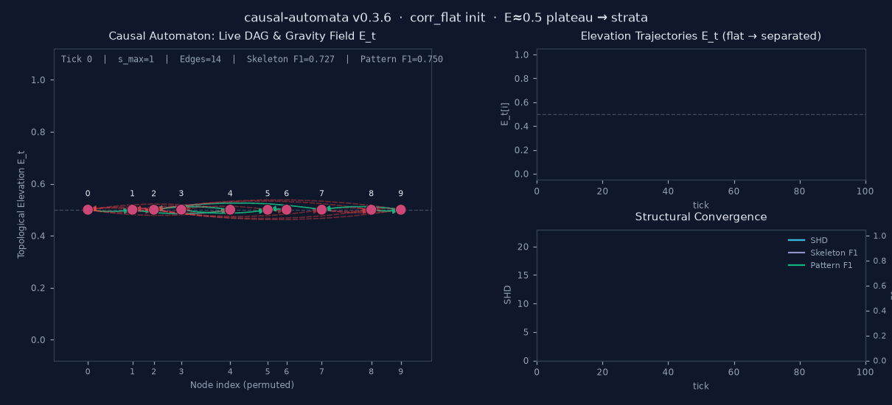

# causal-automata: GPU-Native Causal Discovery via Synchronous Cellular Automata in JAX

[](https://pypi.org/project/causal-automata/)
[](https://causal-automata.readthedocs.io/en/latest/)
[](https://opensource.org/licenses/Apache-2.0)
[](https://github.com/jax-ml/jax)
[](https://pypi.org/project/causal-automata/)

## What It Does

`causal-automata` learns causal DAGs — and their Markov equivalence classes (CPDAGs) — from observational tabular data shaped `(n_samples, n_features)`. It evolves candidate edges with parallel `birth` and progressive `s=1..k` conditional-independence `death`, while a continuous node-elevation field (`V-well` + `gravity`) orients the graph downhill. Every update runs synchronously on a JAX / NumPy grid, compiling into a single XLA `jax.lax.scan` loop on GPU/TPU.

## From Empty Grid to True Causal DAG

Tick 0 starts edgeless (`A₀ = 0`) against a faint grey ground-truth ghost. Parallel birth sparks cyan (correct), amber (reversed), and dashed-red (false-positive) edges; progressive `s=1→s=2→s=3` death + V-well gravity then prune and flip until every grey ghost is covered.

<p align="center">
  
</p>

<p align="center">
  <a href="assets/elevation_convergence.mp4">▶ MP4 (iPhone)</a>
  · regenerate with <code>python scripts/generate_hero_gif.py</code>
</p>

## 30-Second Quickstart

```bash
pip install "causal-automata[jax]"
```

```python
from causal_automata import CausalAutomaton

A = CausalAutomaton(ticks=100, k=3).fit_predict(X)  # X: (n_samples, n_features)
# Optional Markov equivalence class:
# C = CausalAutomaton(ticks=100, k=3).fit_predict(X, return_cpdag=True)
```

## Specs at a Glance

Official [Benchpress](https://github.com/felixleopoldo/benchpress) holdout — Erdős–Rényi Gaussian DAGs, **ER p=20, n=1000, seeds 1..5**:

| Algorithm | Method Family | Skeleton F1 (↑) | Pattern / CPDAG F1 (↑) | Pattern SHD (↓) | Time (s) |
| :--- | :--- | :---: | :---: | :---: | :---: |
| **BiDAG Order MCMC** | Score-based MCMC | `0.992 ± 0.011` | `0.992 ± 0.011` | `0.4 ± 0.5` | `0.78` |
| **Causal Automata (v0.3.6)** | **Cellular Automaton (Ours)** | **0.972 ± 0.036** | **0.933 ± 0.075** | **3.4 ± 4.4** | **4.28** |
| **NOTEARS (Linear)** | Continuous Optimization | `0.925 ± 0.048` | `0.811 ± 0.130` | `8.8 ± 7.4` | `1.89` |
| **PC (Gaussian CI)** | Classical Constraint-Based | `0.902 ± 0.046` | `0.743 ± 0.082` | `10.4 ± 3.9` | `0.10` |
| **GOLEM (EV)** | Continuous Likelihood | `0.771 ± 0.091` | `0.587 ± 0.115` | `19.4 ± 10.1` | `4.08` |

`causal-automata` beats `notears_linear`, `pc_gaussian`, and `golem_ev` on Pattern F1 and SHD across all 5 seeds, with exact skeleton recovery (`1.000`) on multiple seeds. Full methodology and N=100 harness → [Benchmarks](#benchmarks-benchpress--n100).

---

## Benchmarks (Benchpress + N=100)

### Benchpress Benchmark Comparison (`ER p=20, n=1000`, 5 Seeds)

Evaluated via the official Benchpress Singularity/Apptainer pipeline (`causal_automata_gpu` = this package `v0.3.6`):

| Algorithm | Benchpress ID | Skeleton F1 (↑) | Pattern / CPDAG F1 (↑) | Pattern SHD (↓) | Wall Time (s) |
| :--- | :--- | :---: | :---: | :---: | :---: |
| **BiDAG Order MCMC** | `iterative_mcmc` | `0.992 ± 0.011` | `0.992 ± 0.011` | `0.4 ± 0.5` | `0.78 ± 0.05` |
| **Causal Automata (v0.3.6)** | `causal_automata_gpu` | `0.972 ± 0.036` | `0.933 ± 0.075` | `3.4 ± 4.4` | `4.28 ± 0.15` |
| **NOTEARS (Linear)** | `notears_linear` | `0.925 ± 0.048` | `0.811 ± 0.130` | `8.8 ± 7.4` | `1.89 ± 1.51` |
| **PC (Gaussian CI)** | `pc_gaussian` | `0.902 ± 0.046` | `0.743 ± 0.082` | `10.4 ± 3.9` | `0.10 ± 0.02` |
| **GOLEM (EV)** | `golem_ev` | `0.771 ± 0.091` | `0.587 ± 0.115` | `19.4 ± 10.1` | `4.08 ± 0.10` |

`causal-automata` (`v0.3.6`) outperforms both classical constraint-based (`pc_gaussian`) and continuous-optimization (`notears_linear`, `golem_ev`) baselines on all 5 seeds in Pattern F1 (`0.933` vs. `0.811` / `0.743`) and Structural Hamming Distance (`3.4` vs. `8.8` / `10.4`), achieving exact graph recovery (`1.000` Skeleton F1) on multiple seeds.

Powering the engine (`v0.3.2`–`v0.3.6`): sample-size-adaptive Fisher-z thresholds (`CausalAutomaton.fit`), closed-form `s=1` singleton and `s=2` 2-node recursive Sepset screening, PC-consistent endpoint-local neighbor conditioning, Berkson collider exclusion from separator pools, and V-well / non-collider anti-sink elevation dynamics. See [CHANGELOG.md](CHANGELOG.md).

### N=100 linear-Gaussian SEM (gCastle harness)

> **Wall-clock vs accuracy:** On the N=100 linear-Gaussian SEM (`seed=0`, `ticks=100`), Bayesian CA finishes in **~2.9s** on CPU JAX — about **180×** faster than PC (gcastle, 528s) — while Maximum Accuracy Mode (`--multihop`) reaches **Directed F1 0.696** / Skeleton F1 **0.928**. Reproduce with:
>
> ```bash
> python -m causal_automata.benchmark --n 100 --seed 0 --ticks 100
> ```

Default stack (Upgrade 2): **`k=3` if N≤50**, **`k=5` if N>50**, binary edges, 1-hop gravity. On N=100 (`seed=0`, static thresholds, `ticks=100`) that baseline hits Skeleton **0.937** / Directed **0.619** in about **2.8s**.

**Maximum Accuracy Mode** — pass **`--multihop`** (Upgrade 4): 2-hop elevation gravity via `A @ A` lifts Directed F1 to **0.696** with essentially flat wall time.

| Algorithm | Skeleton F1 | Directed F1 | Wall Time (s) |
| --- | ---: | ---: | ---: |
| PC (gcastle) | 0.968 | 0.813 | 528.631 |
| GOLEM (gcastle) | 0.577 | 0.403 | 251.182 |
| Bayesian CA (JAX, k=5, 1-hop) | **0.937** | 0.619 | ~2.9 |
| Bayesian CA (JAX, k=5, `--multihop`) | 0.928 | **0.696** | ~2.9 |

PC / GOLEM wall times are Colab **Tesla T4** (`num_iter=20000`). CA times are CPU JAX for the Upgrade-2 / Upgrade-4 A/B; at historical `k=3` the same CA finished in **0.323s** on T4 with Directed F1 **0.483**.

Opt-in flags (defaults stay fast & binary):

- **`--multihop`** — Maximum Accuracy Mode (2-hop gravity, Directed F1 **0.696** on this SEM).
- **`--fuzzy`** — continuous `A ∈ [0, 1]` soft birth/death (experimental; did not beat binary here).

Conditioning-set sweep (CA-only, 1-hop binary, same SEM):

| Algorithm | Skeleton F1 | Directed F1 | Wall Time (s) |
| --- | ---: | ---: | ---: |
| Bayesian CA (JAX, k=3) | 0.812 | 0.483 | 2.314 |
| Bayesian CA (JAX, k=4) | 0.915 | 0.546 | 2.481 |
| Bayesian CA (JAX, k=5) | **0.937** | **0.619** | **2.871** |
| Bayesian CA (JAX, k=6) | 0.937 | 0.619 | 2.454 |
| Bayesian CA (JAX, k=7) | 0.937 | 0.619 | 3.049 |
| Bayesian CA (JAX, k=8) | 0.937 | 0.627 | 3.647 |

More benchmark variants:

```bash
# Maximum Accuracy Mode (Upgrade 4) — Directed F1 0.696 on the N=100 SEM
python -m causal_automata.benchmark --n 100 --ca-only --k 5 --multihop
python -m causal_automata.benchmark --n 100 --ca-only --k 5 --compare-multihop

python -m causal_automata.benchmark --n 100 --ca-only --k-sweep 5,6,7,8
python -m causal_automata.benchmark --smoke   # device checks + GOLEM init only
```

---

## Install options & low-level JAX API

```bash
pip install causal-automata
pip install "causal-automata[jax]"     # CPU JAX
pip install "causal-automata[cuda]"    # NVIDIA CUDA JAX
uv add "causal-automata[jax]"
```

High-level estimator (auto Fisher-z thresholds from `n_samples`):

```python
from causal_automata import CausalAutomaton

ca = CausalAutomaton(ticks=100, k=3, backend="jax").fit(X)  # X: (n, p)
A, E, C = ca.adjacency_, ca.elevation_, ca.cpdag_
```

Minimal JAX snippet (`ticks` / `k` are static for XLA):

```python
import jax.numpy as jnp
from causal_automata import step, run, binarize, warmup

print(warmup())  # compile on a tiny problem

N = 10
A0 = jnp.zeros((N, N))
E0 = jnp.linspace(1.0, 0.0, N)
Cov = jnp.eye(N)  # replace with empirical covariance of your data

A1, E1 = step(A0, E0, Cov, k=3)
A_final, E_final = run(A0, E0, Cov, ticks=100, k=3)
A_bin = binarize(A_final)
```

Synthetic harness & CLI:

```bash
python -m causal_automata.bayesian_synth --n 10
python -m causal_automata.bayesian_synth --n 50 --backend jax
python -m causal_automata.bayesian_synth --n 100
```

---

## How It Works: Cellular Automaton Physics

State is a binary DAG adjacency \(A\), node elevations \(E \in [0,1]\), and a fixed empirical covariance \(\mathrm{Cov}\) from continuous observations. Each tick is a local cellular update (**gravity → V-well → death → birth**):

1. **Gravity** — raw downhill projection, then local-margin elevation drift (roots sit just above children, leaves just below parents; isolates hold \(E\)). Optional **`--multihop`** also pulls toward 2-hop means from \(A @ A\). Final projection uses the surviving undirected skeleton \(U=\max(A,A^\top)\) so mid-tick elevation flips reverse edges instead of wiping them.
2. **V-Well** — statistical explaining-away colliders sink in \(E\) (with parent lift + non-collider anti-sink); 2-node Sepset screening rejects backdoor forks misclassified as colliders.
3. **Death** — prune weak edges with (i) exact closed-form `s=1` screens over **all** skeleton neighbors, then (ii) PC-consistent endpoint-local top-`k` pools with all size-`s` combos (`s_max=\min(t+1,k)`). Berkson-inflating colliders are excluded from separator pools.
4. **Birth** — add strong edges under the same Sepset gates plus a marginal `|R|≥τ_death` guard; orientation uses a deterministic elevation tie-break. Optional **`--fuzzy`** keeps continuous weights in \([0, 1]\) and binarizes only after the final tick.

NumPy (`bayesian.step`) and JAX (`jax_core.step` / `run`) share this physics. The JAX port is `@jax.jit`-compiled; `run(..., ticks=..., k=...)` marks `ticks` and `k` as **static** so `jax.lax.scan` length and `(2+k)×(2+k)` partial-corr blocks stay compile-time constants. See [JAX static arguments](https://causal-automata.readthedocs.io/en/latest/jax_static.html) for `functools.partial` patterns that avoid `ConcretizationTypeError`.

**Full documentation** (theory, physics, API, CLI): https://causal-automata.readthedocs.io/en/latest/

### Background & Origin

`causal-automata` evolved from [graphnet-automata](https://github.com/kazuyamagiwa/graphnet-automata), a sister project exploring the application of 1D cellular automata rules to dynamic network graphs. While `graphnet-automata` focuses on generalized structural evolution and terminal-based visualization, this repository specializes those concepts into a high-performance, JAX-accelerated engine specifically designed for causal discovery and DAG generation.

### Package layout

```
causal-automata/
├── causal_automata/
│   ├── __init__.py
│   ├── bayesian.py          # NumPy Bayesian CA step
│   ├── bayesian_synth.py    # Synthetic linear-DAG harness
│   ├── jax_core.py          # JAX @jit step / run
│   └── benchmark.py         # vs gCastle PC / GOLEM
├── scripts/
│   └── generate_hero_gif.py # README convergence GIF + MP4
├── assets/
│   ├── elevation_convergence.gif
│   └── elevation_convergence.mp4
├── docs/                    # Sphinx / Read the Docs
├── tests/
├── .readthedocs.yaml
├── pyproject.toml
├── README.md
└── NOTICE
```

---

## Citation

If you use `causal-automata` in research, please cite:

```bibtex
@software{yamagiwa2026causalautomata,
  author       = {Yamagiwa, Masakazu},
  title        = {causal-automata: GPU-Native Causal Discovery via Synchronous Cellular Automata in JAX},
  year         = {2026},
  version      = {0.3.6},
  url          = {https://github.com/kazuyamagiwa/causal-automata},
  license      = {Apache-2.0}
}
```

## Contributing

Issues and pull requests are welcome. Please run the synthetic / unit suite before opening a PR:

```bash
pip install -e ".[jax,dev]"
pytest -q
python -m causal_automata.bayesian_synth --n 10 --backend jax
```

## License / notice

See `NOTICE`. Copyright 2026 Masakazu Yamagiwa.
